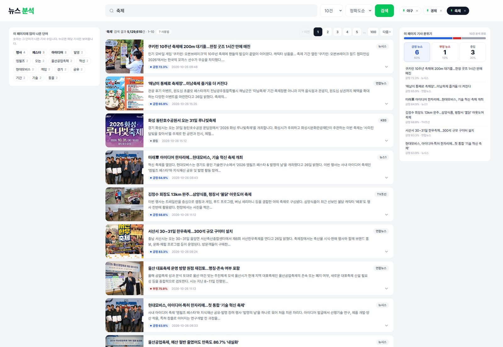
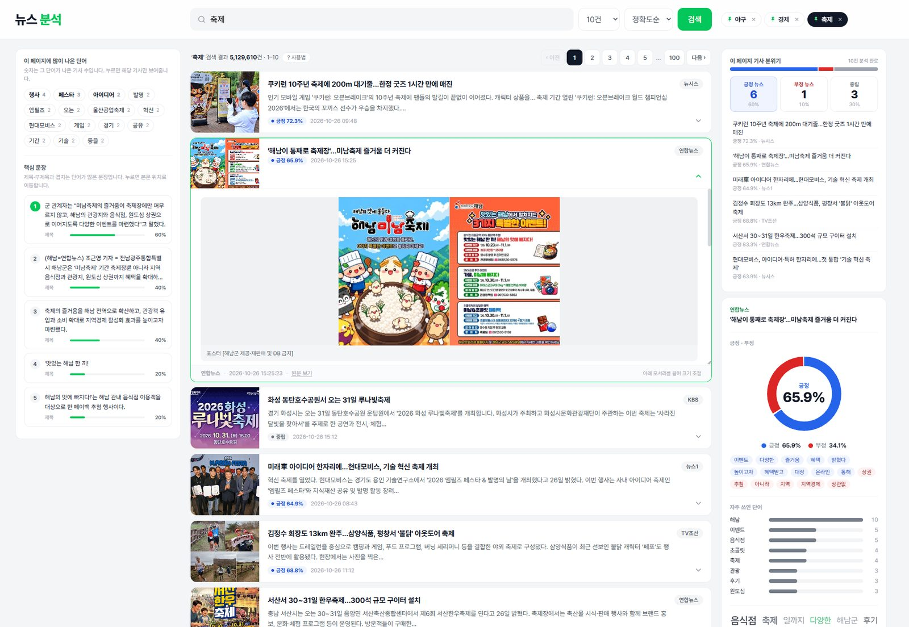

**English** | [한국어](README.md)

# news_Moa · News Analysis

A web service that collects Naver News search results and instantly shows each article's **positive/negative tone**, **key keywords**, and **key sentences**.
Unlike existing news analytics services that focus on search volume and mention counts, it is designed to help you **quickly understand "what is actually being said" while reading the articles themselves**.





---

## What Makes It Different

### 1. Sentiment analysis that shows its evidence, not just a number
Instead of only saying "65.9% positive", it shows the **sentiment words behind the decision**, so you can open the article and check right away whether the judgment holds.
Even in the list, every article carries a positive/negative/neutral badge and a colored strip on the card edge, so the mood of the page is readable just by scrolling.

### 2. Jump straight to the "key sentences" that match the headline
Sentences containing the most nouns from the headline and subheadline are ranked. Clicking one **scrolls the article box to that sentence and highlights it in yellow**, so even long articles can be read starting from the core paragraph.

### 3. Reading by "expanding the article body" instead of a blocked original page
The first plan was to show the original article in a popup (iframe), but a check script showed that many publishers block iframes (7 of 20). The design was changed so the server **extracts the body text, subheadline, and photos and expands them under the card**. Naver News body extraction succeeded 7/7; when extraction fails, the search summary is analyzed instead and the screen says so.

### 4. Stackable filters by word and publisher
Selecting a frequent word and a publisher together keeps only the matching articles (e.g., "contains ‘AI’ · Yonhap News · 2 articles") and highlights the word. Empty date dividers are hidden, and if nothing matches, a button to clear the filter is shown.

### 5. A screen for both first-time users and power users
- **5-step tutorial**: real screenshots side by side with explanations; once closed, it stays closed.
- **Expert mode**: the screen stays simple by default; turning the switch on adds a page-wide keyword map and an article time distribution.
- **Dark mode**: follows the OS theme and can be switched with a button. Cards and photos get white borders so they don't blend into the dark background.

### 6. A layout that doesn't break at any screen size
- When a side panel is taller than the window, it scrolls with the page and **sticks once its bottom reaches the bottom of the window**, so everything is visible without an inner scrollbar.
- Images are size-checked first: **icons and logos are skipped**, tall photos don't stretch cards, and small photos aren't upscaled into blur.
- Article box height, pinned searches, recent searches, theme, and expert mode are remembered in the browser.

---

## Features

### Search
- Article search via the Naver News Search API (10/20/50/100 results, by relevance or date). Changing the count or sort re-runs the search immediately
- The home screen starts with a default query (`축제`, "festival")
- Page navigation at the top and bottom (up to 1,000 results, the API limit)
- **Pinned searches**: pin frequent queries to the header, remove with ×, add the current query with `+`
- Recent search history (up to 8)

### Article List
- **Thumbnails** taken from the article pages and **publisher names** resolved from the original URL (about 70 outlets; otherwise the page's `og:site_name`)
- **Positive (blue) / negative (red) / neutral (gray) badges** and a colored strip on the right edge of each card
- Date dividers such as **"Today · Mon, Oct 26 news"** wherever the date changes
- Clicking a **frequent word** or a **publisher** on the left shows only the matching articles (can be combined)

### Reading an Article
- Clicking an article expands its **body, subheadline, and photos** below it (most publishers block iframes, so the body is extracted directly)
- The article box scrolls internally and can be resized from its bottom corner; the size is remembered
- **Key sentences** on the left: sentences ranked by overlap with the headline and subheadline. Clicking one jumps to it in the body and highlights it
- **Article analysis** on the right: positive/negative donut chart, the sentiment words used as evidence, frequent words, and a word cloud

### Page Overview
- **Page mood** (top right): number and share of positive/negative/neutral articles. Clicking an article in the list jumps to it and expands it
- **Expert mode** switch: adds "Keywords at a Glance" (page-wide word size map) and "Article Time Distribution" (articles per date/time slot)

### Interface
- **Dark mode**: follows the OS theme; a header button cycles System → Dark → Light. In dark mode, cards and photos get white borders
- 5-step tutorial panel (remembered when closed, reopen with `? 사용법`)
- Side panels stick at the bottom when taller than the window (no inner scrollbars)
- Image size check: small images such as icons and logos are excluded, and tall photos don't change card height

---

## How the Analysis Works

| Item | Method |
|---|---|
| Positive / negative | Sums word polarity (-2 to 2) from the [KNU Korean Sentiment Lexicon](https://github.com/park1200656/KnuSentiLex). Negations such as `좋지 않다` ("not good") and `안 좋다` flip the polarity. 60% or more on one side → positive/negative, otherwise neutral |
| Morphological analysis | Uses `kiwipiepy`. Where it can't be installed, falls back automatically to a simple analyzer that strips Korean particles |
| Key keywords | Noun frequency per article; for the whole page, ranked by how many articles contain the word. The search query itself is excluded |
| Key sentences | How many headline nouns a sentence contains (60%) + how many subheadline nouns it contains (40%) |
| Body extraction | The body area (`#dic_area`) for Naver News pages; `trafilatura` or a simple extractor for publisher pages. On failure, the search summary is analyzed and the screen shows a notice |

> AI (OpenAI) analysis is planned as the next step; the current version includes only rule-based Python analysis.

---

## Structure

```txt
news_Moa/
  main.py                 Flask web server (pages + API)
  components/
    naver_news_search.py  Naver News Search API calls and result cleanup
    article_fetcher.py    Article body, subheadline, photos, publisher name (cached)
    text_analyzer.py      Sentiment, keywords, key sentences, page keywords
    press.py              Original URL → publisher name
  templates/index.html    UI (HTML, CSS, and JS in one file)
  static/tutorial/        Tutorial images
  check_article_fetch.py  Script that checks whether bodies/photos can be fetched from API result links
  docs/                   README screenshots
```

| Endpoint | Description |
|---|---|
| `GET /` | Search page (`query`, `display`, `start`, `sort`) |
| `GET /api/news` | Search results as JSON |
| `GET /api/preview` | For the list: thumbnail candidates, publisher name, positive/negative verdict |
| `GET /api/article` | Article body + analysis (paragraphs/sentences, sentiment, keywords, key sentences) |

---

## Getting Started

```bash
pip install -r requirements.txt
python main.py        # http://127.0.0.1:5000
```

- **API key**: kept out of the repository in `C:\keydata\naver.py`. For another location, set the `NAVER_KEY_FILE` environment variable.
  ```python
  CLIENT_ID = "Naver Developers Client ID"
  CLIENT_SECRET = "Client Secret"
  ```
- **Sentiment lexicon**: downloaded automatically to `data/SentiWord_info.json` on first run (publicly released for research; excluded from the repo via `.gitignore`).
- On Python versions where `kiwipiepy` can't be installed, the simple analyzer is used. You can see which one is active at the bottom right of the article analysis panel ("형태소 분석: simple/kiwipiepy").

---

## Verification Results

Results of checking 20 real API results with `check_article_fetch.py`.

| Item | Result |
|---|---|
| Share of Naver News links | 7/20 (35%) |
| Naver News body extraction | 7/7 succeeded |
| Publisher page body extraction | 15/20 succeeded |
| iframe (embedding the original page) blocked | 7/20 → chose to extract and expand the body directly |

---

## Problems Solved During Development

| Problem | Cause | Fix |
|---|---|---|
| Showing the original article in an overlay gave a blank screen | Publishers and Naver block iframes | The server extracts the body and expands it under the card |
| Tall photos stretched cards to 446px; small photos were upscaled and blurry | Thumbnail height followed the photo's ratio; the gallery always filled its frame | Thumbnails fill and crop their slot; body photos are never shown larger than their original size; images under 100×60 are excluded |
| `&quot;` and `<b>` showed up in titles | API responses include HTML entities and tags | Strip tags + `html.unescape` |
| Some publisher pages had garbled text | EUC-KR pages that don't declare their encoding | Detect the encoding from the content |
| Scrollbars appeared inside the side panels | The sticky panels had a max height | Removed the height limit; panels taller than the window stick at the bottom |
| Panel positions were off after zooming the page to 110% | The zoom factor wasn't applied to the window-height calculation | Read the zoom factor and correct the calculation |
| The center column went blank when filters matched nothing | No message for zero results | "No matching articles" message + clear button |
| The API key was in the code | Initial sample code | Read the key from a file outside the repository |

---

## Next Steps

- Add OpenAI analysis: compare side by side with the Python results and highlight the sentences behind each judgment
- Group articles about the same event; compare tone across publishers
- Tutorial images for dark mode
- Review the Naver Search API terms (revised 2026.09, restricting AI use) — required before any commercial use
- Article photos and text are copyrighted: for personal analysis only
